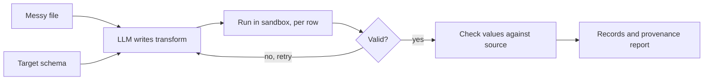

# Schema Mapper

Turn messy client data into a clean target format, with checks on every row and every value.

**Live demo:** https://ai-schema-mapper.streamlit.app
*(Free tier: the first load can take about 30 seconds, and daily model calls are capped.)*

## The problem

Client files rarely match the format a platform expects:

- Dates: `15/04/2026`, `4 Mar 2026`
- Prices: `$1,299.99`, `€1.234,50`
- Weights: `2.5 kg`, `2500 g`
- Column names that don't match the target

## What it does

1. You upload the messy file and describe the target format as a schema.
2. An LLM writes one `transform(row)` function.
3. That function runs on every row, inside a sandbox.
4. Each output row is validated against the schema.
5. Each output value is checked against the source data.
6. Failures are shown, never hidden. A missing field raises an error instead of being filled with `0` or an empty string.



## Try it in 30 seconds

1. Open the live demo, or run it locally (see below).
2. Upload `evals/cases/case6/input.json`.
3. Choose **C. Paste your schema** and paste the contents of `evals/cases/case6/schema.json`.
4. Click **Map data**.

Expected: 3 records, 0 errors, and weights of 2500, 2500, and 500.

## Run locally

Requires Python 3.12 or newer.

```
git clone https://github.com/sanjanaupase/schema-mapper.git
cd schema-mapper
bash run.sh
```

Then open http://localhost:8501.

`run.sh` installs the pinned dependencies and starts the app. Model settings come from the environment. Locally they are read from a `.env` file, which is git-ignored and never committed.

## Using the app

| Step | What to do |
|---|---|
| 1. Upload | One or more CSV or JSON files |
| 2. Target schema | **C. Paste** your schema (the normal flow). **A. Infer** it from one correct sample output. **B. AI draft** (experimental, review it first) |
| 3. Map | Click **Map data** |
| 4. Review | Check the records, the errors, and the provenance report |
| 5. Optional | Save as approved mapping, push to CRM, or run a batch |

Use **Clear all** to reset everything before the next run.

## What you get back

- Mapped records, downloadable as JSON or CSV
- Errors for each row, with the reason
- A provenance report: for each field, how many values were copied, converted, not found in the source, or empty
- The generated code, so you can read exactly what ran

## Results

Model: `gemini-3.5-flash-lite`. Nine hand-labeled cases.

| Run | First attempt only | With retries (up to 3) |
|---|---|---|
| All 9 cases, 1 run | 9/9 | 9/9 |
| 6 cases, 5 runs each | 29/30 | 30/30 |

- Retries rarely fire. Only 1 of 210 agent runs needed one, and it recovered. They are a safety net, not the main source of accuracy.
- One miss in 30 runs did not repeat in 10 more runs.
- Typical latency is 1.5 to 3 seconds per file.

To run the evaluation yourself:

```
DAILY_CALL_LIMIT=0 RUNS=1 python evals/run_evals.py
```

The cases cover column renames, currency strings, European decimals, mixed dates, unit conversion, strict rules, derived values, and recomputed totals. See `evals/cases/`.

## How it works

- **Agent:** a LangGraph state machine (generate, execute, validate, retry)
- **Model calls:** LangChain structured output into a Pydantic model
- **Sandbox:** generated code runs in a subprocess with a timeout and a memory limit
- **Privacy:** emails, phone numbers, and keys are redacted before they reach prompts or logs
- **Reuse:** approved mappings are saved and retrieved for similar files
- **Integration:** CRM push with idempotency keys and retries on 429 and 5xx responses
- **Cost control:** a daily cap on model calls

## Limitations

- The sandbox is not a security boundary. Production use needs a container or an isolated service such as E2B.
- Provenance checks that a value exists in the source, not which column it came from.
- Batches run one file at a time.
- Large files are processed in 500-row chunks. Very large files need a background job.
- Reuse uses keyword similarity, not embeddings.
- The CRM is a mock unless you configure a real endpoint.
- The public demo's quota counter resets when the app restarts.
- AI schema drafting (mode B) is experimental. Review its output before use.

## Project layout

```
app.py                  Streamlit UI
run.sh                  one-command local start
src/mapper/
  agent.py              LangGraph loop: generate, execute, validate, retry
  sandbox.py            subprocess execution with limits
  schemas.py            Pydantic models
  redact.py             PII and key redaction
  infer_types.py        schema inference from a clean example
  provenance.py         per-field grounding check
  rag.py                approved-mapping store and retrieval
  crm.py                push with idempotency keys and retries
  limits.py             daily model-call cap
  suggest.py            AI schema draft (experimental)
  api.py                FastAPI endpoints
evals/
  run_evals.py          evaluation harness
  cases/                nine cases: inputs, schemas, expected outputs
tests/test_agent.py     unit tests
```

## Tests

```
pytest -q
```

Expected: `5 passed`. The tests use a fake model, so they need no model access and no quota.

## License

MIT
