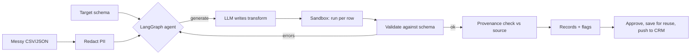

# Schema Mapper: an LLM data-onboarding agent

Turns messy CSV or JSON from a client into a target schema. Every output row is validated against the schema, and every output value is checked against the source data.

**Live demo:** https://ai-schema-mapper.streamlit.app
*(Free tier: the first load can be slow, and daily model calls are capped.)*

  

---

## What it does

Client data rarely matches the format a platform expects. Dates come in several styles, prices look like `"$1,299.99"` or `"1.234,50 €"`, weights are `"2.5 kg"`, and column names don't match. This tool maps that data to a target schema with four guarantees:

1. **Generated code, not generated rows.** The model writes one `transform(row)` function, which runs locally on every row. Cost doesn't grow with file size.
2. **Validation.** Every output row is checked against the JSON Schema. Failed rows are reported, not hidden.
3. **Grounding.** Each output value is compared with the source data. Copied and unit-converted values are marked as found. Values the source doesn't support are flagged for review.
4. **Refusal over invention.** If a target field has no source column, the transform raises an error. It never fills in `0` or an empty string.



## Features

| Area | What's built |
|---|---|
| Data onboarding | CSV and JSON input, row preview, currency, decimal, date, and unit normalization through generated code |
| Schema | Paste your own, infer from a clean example, or AI draft (experimental) |
| Agent | LangGraph state machine: generate, execute, validate, retry, finish. Retry branches are unit-tested |
| Structured output | LangChain `with_structured_output` into a Pydantic model |
| Safety | PII redaction before prompts and logs. Sandbox with a timeout, memory limit, and cleared environment |
| Grounding | Per-field provenance report: copied, normalized, unsupported, null |
| Reuse | Approved mappings saved and retrieved by TF-IDF similarity, then added to future prompts |
| Integration | CRM push with idempotency keys, retries on 429 and 5xx, `Retry-After` support, dead-letter list |
| Scale | Batch of many files with one schema, per-file status, combined downloads |
| Cost control | Daily model-call cap with a visible counter |
| Evaluation | 9 hand-labeled cases, two modes, repeated runs, failure details |

## Run locally

Requires Python 3.12 or newer.

```bash
git clone https://github.com/sanjanaupase/schema-mapper.git
cd schema-mapper
bash run.sh
```

Open http://localhost:8501. `run.sh` creates the virtual environment, installs pinned dependencies, and starts the app. The app reads its model settings from the environment. `run.sh` loads them from a local `.env` file, which is git-ignored and never committed.

## Using the app

1. **Upload** one or more messy CSV or JSON files.
2. **Set the target schema:**
   - **C. Paste your schema** (the normal client flow)
   - **A. Infer from a clean example** (upload one correct output file, and the schema is inferred from it)
   - **B. Draft with AI** (experimental, review before use)
3. **Click Map data**, then check the provenance report and any flagged values.
4. Optional: **Save as approved mapping** (reused for similar files), **Push to CRM**, or **Run batch** for many files.

Try the included case: upload `evals/cases/case6/input.json`, choose C, and paste `evals/cases/case6/schema.json`. Expected: 3 records, 0 errors, and `weight_g` values of 2500, 2500, and 500.

## Evaluation

The harness has nine hand-labeled cases in `evals/cases/`. Each case has an input file, a `schema.json`, and an `expected.json`.

| Case | Challenge |
|---|---|
| case1 | Column renames, quoted numbers, emails |
| case2 | Currency strings (`$1,299.99`) and yes/no booleans |
| case3 | Currency with thousands separators |
| case4 | Mixed date formats (`15/04/2026`, `4 Mar 2026`) and blank fields |
| case5 | European decimals (`€1.234,50`) and split names |
| case6 | Unit conversion (`2.5 kg`, `2500 g`) |
| case7 | Strict enum, regex pattern, age parsed from text |
| case8 | Values derived from rules in the schema (VAT by country) |
| case9 | Recomputing a total and flagging a mismatch |

```bash
DAILY_CALL_LIMIT=0 RUNS=1 python evals/run_evals.py    # one run per case
DAILY_CALL_LIMIT=0 RUNS=5 python evals/run_evals.py    # repeated runs
```

`DAILY_CALL_LIMIT=0` turns off the app's quota counter, so evals don't use the demo budget.

### Results (gemini-3.5-flash-lite)

| Run | Single attempt (baseline) | With retries (agent, up to 3) |
|---|---|---|
| All 9 cases, 1 run each | 9/9 | 9/9 |
| 6 cases, 5 runs each (30 per mode) | 29/30 | 30/30 |
| case7 (strict rules), 30 runs | 30/30 | 30/30 |

How to read these:

- On these cases the model is usually right on the first attempt. **Retries rarely fire:** 1 of 210 agent runs needed one, and it recovered. Retries are a safety net, not the main source of accuracy.
- One baseline miss appeared in 30 runs. It did not reproduce in a follow-up run of 10. Treat the failure rate as about 1 in 30 or lower, not zero.
- Switching to LangChain briefly broke case4's date conversion. The fix was to state the format explicitly in the schema field and the prompt. The case has passed in every run since.

Latency is typically 1.5 to 3 seconds per file. Spikes of 10 to 50 seconds happened when the model was under load.

## Limitations

- **The sandbox is not a security boundary.** Generated code runs in a local subprocess with a timeout, a memory limit, and a cleared environment. Production use needs a container or an isolated service such as E2B.
- **Provenance is lenient.** It checks that a value exists in the source, after number and whitespace normalization. It does not check which column the value came from, so a coincidental match is possible.
- **Batches run sequentially.** Large batches are slow. Parallel workers are the next step.
- **Chunking.** Execution runs in chunks of 500 rows, with a 5-second timeout per chunk. Very large files need a larger chunk size or a background job.
- **Retrieval is keyword-based.** Approved mappings are matched with TF-IDF, not embeddings or a vector database. That's fine for hundreds of mappings, not thousands.
- **The CRM is a mock by default.** It simulates 429 responses to exercise the retry path. Connect a real endpoint through configuration before using it with live data.
- **The deployed quota counter resets on restart.** The real hard limit is a billing budget. The public app currently runs on the free tier with no billing account.
- **AI schema drafting (mode B) is experimental.** It has produced wrong types, so always review a draft before mapping.

## Project structure

```
app.py                  Streamlit UI
run.sh                  one-command local start
src/mapper/
  agent.py              LangGraph loop: generate, execute, validate, retry
  sandbox.py            subprocess execution with limits
  schemas.py            Pydantic models (CodeResponse, MappingResult)
  redact.py             PII and key redaction
  infer_types.py        schema inference from a clean example
  provenance.py         per-field grounding check
  rag.py                approved-mapping store and retrieval
  crm.py                push with idempotency keys and retries
  limits.py             daily model-call cap
  suggest.py            AI schema draft (experimental)
  header_suggest.py     header-name heuristics (experiment, not used in app)
  profile_suggest.py    column profiling (helper)
  consensus_suggest.py  multi-draft voting (experiment, not used in app)
  api.py                FastAPI endpoints (/map, /map_json)
evals/
  run_evals.py          evaluation harness
  score_suggest.py      scores inference methods (experiment)
  score_llm.py          scores the LLM draft (experiment)
  cases/case1..case9/   inputs, schemas, expected outputs
tests/test_agent.py     unit tests: graph branches, redaction, sandbox timeout
```

## Tests

```bash
pytest -q
```

Expected: `5 passed`. The tests use a fake model, so they need no model access and use no quota.

## Deploy your own copy

1. Push the repo to your GitHub account.
2. At https://share.streamlit.io, click **Create app**, select the repo, branch `main`, and main file `app.py`.
3. Set the model credentials and any limits in the platform's **Secrets** settings. Never put credentials in code or in Git.

## Roadmap

- Parallel batch workers and a job queue for large files
- Container-based sandbox (E2B or Docker) in place of the local subprocess
- Column-level provenance, so each value traces to its source column
- Embedding-based retrieval for approved mappings
- Per-record approval before CRM push
- Real CRM connector with integration tests against a staging endpoint

## License

MIT. See [LICENSE](LICENSE).
